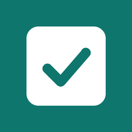
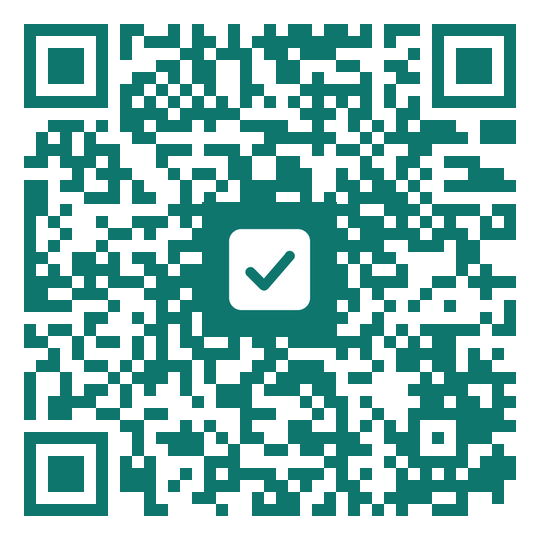

<div align="center">



# Familjelistan

**Familjens gemensamma att göra-listor – på iPhone och Android.**

### [👉 Öppna appen](https://antonhellqvist.github.io/familjelistan/)

`https://antonhellqvist.github.io/familjelistan/`



*Skanna med kameran i telefonen*

</div>

---

## 📲 Installera på telefonen

Appen installeras direkt från webben. Du behöver inte gå via App Store eller Google Play.

<table>
<tr>
<th width="50%">🍎 iPhone</th>
<th width="50%">🤖 Samsung / Android</th>
</tr>
<tr valign="top">
<td>

1. Öppna länken i **Safari**
   *(det måste vara Safari)*
2. Tryck på **Dela** <kbd>⬆️</kbd> längst ner
3. Scrolla ner och välj **Lägg till på hemskärmen**
4. Tryck **Lägg till**
5. Öppna appen **från hemskärmen**

</td>
<td>

1. Öppna länken i **Chrome** eller **Samsung Internet**
2. Tryck på menyn <kbd>⋮</kbd> eller <kbd>☰</kbd>
3. Välj **Installera app** eller **Lägg till på startskärmen**
4. Öppna appen från startskärmen

</td>
</tr>
</table>

### Första gången

- **Den första i familjen** skriver namn, e-post och lösenord och väljer **Skapa ny familj**.
- Gå sedan till fliken **Familj** → **Dela inbjudan** och skicka länken till de andra.
- **De andra** öppnar inbjudningslänken, skapar ett konto med sin e-post och är med direkt.
- **Ny telefon?** Välj **Logga in** och använd samma e-post och lösenord.
- Vill du ha påminnelser? Gå till **Familj** → **Slå på notiser**.

> 💡 **På iPhone:** lägg till appen på hemskärmen *innan* du skapar ditt konto, och logga sedan in där. Safari och appen på hemskärmen loggas in var för sig.

---

## ✨ Det här kan appen

| | |
|---|---|
| 📋 **Delade listor** | Alla kan skapa listor, till exempel *Att göra*, *Handla* och *Semester*. |
| ⚡ **Synkas direkt** | När någon bockar av något syns det på allas telefoner samtidigt. |
| 🔐 **Eget konto** | Logga in med e-post. Byt telefon utan att tappa något. |
| ⭐ **Viktigt** | Stjärnmärk det som måste bli gjort. Det visas först och lyfts fram i påminnelsen. |
| 👤 **Vem gör vad** | Ge uppgifter till en person. Var och en har en egen färg. |
| 📅 **Datum** | Vyn *Idag* visar det som ska göras idag och det som är försenat. |
| 🔁 **Återkommande** | *Ta ut soporna varje tisdag* dyker upp igen av sig själv. |
| 🛒 **Smart inköpslista** | Varorna sorteras efter butikens avdelningar, och vanliga varor föreslås. |
| 📆 **Kalender** | Uppgifter med datum hamnar automatiskt i kalendern. Lägg till händelser, deadlines och födelsedagar. |
| 🎂 **Födelsedagar och temadagar** | Namnsdagar, helgdagar och temadagar som kanelbullens dag och fettisdagen, plus hur gammal någon fyller. |
| 🧹 **Sysslor och statistik** | Tryck när du plockat diskmaskinen eller dammsugit, och se topplistan för veckan, månaden och året. |
| 🔔 **Påminnelser** | En notis kl. 07 om dagens uppgifter och födelsedagar, och när någon ger dig en uppgift. |
| 📴 **Fungerar offline** | Ändringar synkas när telefonen är uppkopplad igen. |

### Snabbinmatning

Skriv som du pratar, så fyller appen i resten:

```
Byt däck imorgon @Pappa
Ta ut soporna varje tisdag
Ring tandläkaren på fredag
Betala hyran ! @Mamma          ← ! eller "viktigt" ger en stjärna
mjölk, bröd, ägg, bananer      ← i en inköpslista
```

---

<details>
<summary><b>🛠️ För den som underhåller appen</b></summary>

<br>

| Del | Var |
|---|---|
| Appen | `docs/` – publiceras med GitHub Pages |
| Databas och konton | Firebase Firestore + Authentication (e-post/lösenord) |
| Säkerhetsregler | `firestore.rules` – klistras in i Firebase-konsolen |
| Påminnelser | `reminders/` + `.github/workflows/` – GitHub Actions var 15:e minut |

Hela uppsättningen steg för steg finns i **[GUIDE.md](GUIDE.md)**.

</details>
